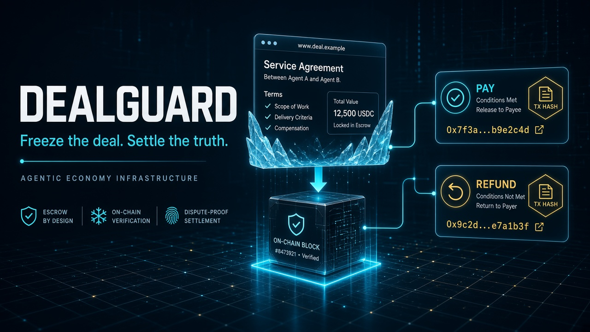
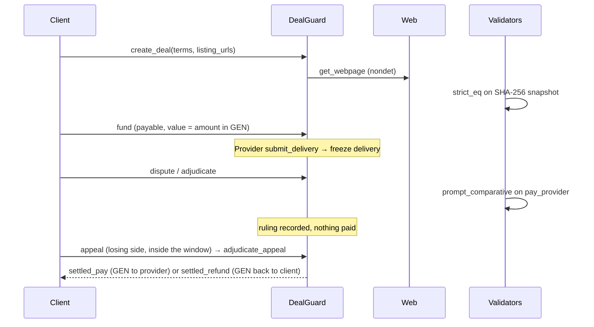

# DealGuard

<p align="center">
  
</p>

<p align="center">
  <strong>Agentic commerce escrow that adjudicates frozen web evidence — not rotting live URLs.</strong>
</p>

<p align="center">
  <a href="https://valentinzubok.github.io/DealGuard/"></a>
  <a href="https://explorer-studio-dev.genlayer.com/address/0x9d2F35936528981aab4D3095a1eE93878C7D4E63"></a>
  <a href="https://valentinzubok.github.io/DealGuard/console/"></a>
</p>

<p align="center">
  
  
  
  
</p>

| | |
|---|---|
| **Website** | https://valentinzubok.github.io/DealGuard/ |
| **Contract (Studio Dev, chain 61997)** | [`0x9d2F35936528981aab4D3095a1eE93878C7D4E63`](https://explorer-studio-dev.genlayer.com/address/0x9d2F35936528981aab4D3095a1eE93878C7D4E63) · [deploy record](STUDIO_DEV_DEPLOY.md) |
| **Demo video** | [`assets/demo/dealguard-demo.mp4`](https://github.com/valentinzubok/DealGuard/blob/main/assets/demo/dealguard-demo.mp4) (2:45, real Studio Dev txs) |
| **Live app** | https://valentinzubok.github.io/DealGuard/console/ — MetaMask reads/writes the contract |
| **Studio** | https://studio-dev.genlayer.com/run-debug |
| **Quickstart** | [Site guide](https://valentinzubok.github.io/DealGuard/quickstart/) · [`docs/STUDIO.md`](docs/STUDIO.md) |
| **Evidence explorer** | https://valentinzubok.github.io/DealGuard/evidence-explorer/ |
| **Changelog** | [`CHANGELOG.md`](CHANGELOG.md) · [site](https://valentinzubok.github.io/DealGuard/changelog/) |

---

## Why it exists

Agents already buy, sell, and dispute from the open web. Between deal open and adjudication the listing changes, the delivery page rotates, or an attacker swaps the URL. That is **URL rot** — and most escrow still points judges at live links.

**DealGuard** is the missing commerce primitive:

1. **Freeze** listing URLs at deal open (SHA-256 + validator consensus)
2. **Escrow** the price in native GEN: `fund()` is payable and the money sits in the contract
3. **Freeze** delivery evidence when the provider submits
4. **Adjudicate** with GenLayer LLMs against **frozen** snapshots only. The result is a ruling, not a payment: the losing side has a committed window to **appeal** to a second, independent round
5. **Cross-check** later to prove drift / tamper
6. **Pay out** on the verdict: to the provider, or back to the client. No third exit
7. **Score** party reputation from outcomes

Not another wrapper agent. Infrastructure other agent marketplaces compose.



---

## v4: a deadline that splits time in two, and no refund from a partial reading

Reviews of other GenLayer escrows kept asking the same questions. v4 answers them in DealGuard.

| Question | v3 | v4 |
|---|---|---|
| A delivery nobody ruled on | stayed delivered for ever | `expire_review` after the committed `review_window` (120 s – 30 d, default 7 d): the client is refunded, or an appealed ruling stands |
| Can transaction order choose the outcome? | a client could release while a stranger refunded | `release`, `dispute`, `adjudicate` and `adjudicate_appeal` work only **before** the review deadline, `expire_review` only **at or after** it; `get_schedule` never offers both |
| A refund when the judge saw only part of a page | possible | the round is `inconclusive` and moves nothing. A payment decided from the excerpts it did see still counts |
| What the judge read | a counter | every round kept: `get_round(deal_id, n)` has the kind, the time, the model's answer, the verdict, whether the reading was complete, the hash and characters read of each page |
| Registry size | one JSON blob rewritten on every call, events capped at 200 | `TreeMap` per entry plus a `DynArray` index; `list_deals(offset, limit)` and `get_events(offset, limit)` are paged; `get_stats` is a running counter |
| Linter | bare `Exception` | `gl.vm.UserError` everywhere, `genvm-lint` clean in CI |
| Runner | `5jycge4q8…` (no longer accepted by Studio Dev) | `babwp9t3…` |

The owner still has only `pin_code_snapshot` and `transfer_ownership`: neither touches a deal.
[`tests/test_v4.py`](tests/test_v4.py) has 36 tests for this; the on-chain record is in
[`STUDIO_DEV_DEPLOY.md`](STUDIO_DEV_DEPLOY.md) and the build record in
[`docs/MILESTONE_V4_HARDENING.md`](docs/MILESTONE_V4_HARDENING.md).

---

## v3: a verdict is a ruling, not a payment

In v2 one consensus round moved the escrow at once. Anyone could call `adjudicate` the moment a
delivery was frozen, the provider included, and a single wrong verdict was final: there was no
second look and no time for the other side to object. v3 separates the ruling from the payment.

| | v2 | v3 |
|---|---|---|
| What `adjudicate` does | decides and pays in one transaction | records a ruling; the escrow does not move |
| A wrong first verdict | final | the side it went against appeals inside `appeal_window`; a second, independent round decides |
| Who may appeal | n/a | only the losing side, once, only while the window is open |
| What the second round sees | n/a | the same frozen evidence and the grounds, fenced as an argument. Not the first ruling |
| When money moves | on the first verdict | on the appeal verdict, or on `settle` after the window passes unused |
| Rule + pay in one breath | possible | impossible: `settle` reverts until the window has fully elapsed |

`appeal_window` is fixed in `create_deal` (60 seconds to 30 days) and has no setter. It is elapsed
time since the ruling, not a calendar window. [`tests/test_appeal.py`](tests/test_appeal.py) has
32 tests for this, and the on-chain record shows an appeal decided by a second round, a ruling
settled after an unused window, and every refused shortcut.

---

## v2: the escrow holds real GEN

v1 moved bookkeeping units that the contract owner minted with `credit()`, and the owner could
release or dispute any deal. Nothing was at stake. v2 removes all of that.

| | v1 | v2 |
|---|---|---|
| What is escrowed | units minted by the owner | native GEN sent with `fund()` |
| Who can release | client **or owner** | client only |
| Who can dispute | parties **or owner** | parties only |
| Provider never delivers | funds stuck until someone acts | `reclaim()` after the committed `delivery_window` |
| A refused `fund()` | n/a | never reverts with value attached; the amount becomes a credit the sender withdraws |
| How money leaves | a number changes | an external transfer to the provider's or the client's wallet, after state is updated |

Two facts about the network shaped the money code, and both were checked on chain: value
attached to a call that reverts is not returned, and an internal message to a wallet pays
nobody. So `fund()` does not raise once value is attached, and payouts go out as external
transfers through an EVM interface. [`tests/test_escrow.py`](tests/test_escrow.py) holds the
contract to this: after every step of a random run, the contract balance equals open escrow
plus credits.

---

## Stack (what this repo is)

| Layer | Tech | Notes |
|-------|------|--------|
| Intelligent Contract | Python GenLayer IC | [`contracts/DealGuard.py`](contracts/DealGuard.py) — **not** Solidity / genlayer-js SPA |
| Integrity pack | JSON + schemas + CI | `CODE_SNAPSHOT.json`, `schemas/`, `scripts/` |
| Product site | **Next.js 15 + TypeScript** static export | `web/` → GitHub Pages (`/DealGuard` basePath) |
| CI / CD | GitHub Actions | [`.github/workflows/ci.yml`](.github/workflows/ci.yml) + [Pages](.github/workflows/pages.yml) |

---

## Getting Started

### 1) Clone & verify contract tests

```bash
git clone https://github.com/valentinzubok/DealGuard.git
cd DealGuard
python3 -m pip install -r requirements-dev.txt
python3 scripts/update_code_snapshot.py verify
python3 scripts/validate_schemas.py
python3 -m pytest -q
```

### 2) Run the website locally

```bash
cd web
npm install
npm run dev
# → http://localhost:3010
```

Optional typecheck:

```bash
cd web && npx tsc --noEmit
```

For a Pages-like build (with basePath):

```bash
cd web
NEXT_PUBLIC_BASE_PATH=/DealGuard NEXT_BASE_PATH=/DealGuard npm run build
# static files in web/out/
```

No `.env` is required: the app defaults to the live Studio Dev contract `0x9d2F35936528981aab4D3095a1eE93878C7D4E63` (override with `NEXT_PUBLIC_DEALGUARD_ADDRESS`). Open `/console/` and connect MetaMask — it switches to chain 61997.

### 3) Deploy / use the live demo on Studio

1. Open [GenLayer Studio Dev](https://studio-dev.genlayer.com/run-debug) (chain 61997)
2. Paste [`contracts/DealGuard.py`](contracts/DealGuard.py) **or** use the [already-deployed contract](https://explorer-studio-dev.genlayer.com/address/0x9d2F35936528981aab4D3095a1eE93878C7D4E63) from the [live console](https://valentinzubok.github.io/DealGuard/console/)
3. Follow [Quickstart on the site](https://valentinzubok.github.io/DealGuard/quickstart/) or [`examples/demo_flow.md`](examples/demo_flow.md)

Demo listing URL:

```json
["https://test-server.genlayer.com/static/genvm/hello.html"]
```

Delivery fixtures used on chain: [`delivery-ok.html`](web/public/fixtures/delivery-ok.html) and [`delivery-placeholder.html`](web/public/fixtures/delivery-placeholder.html).

**Read-only path (no wallet):** `get_stats` → `list_deals` → `get_deal("appeal-1")` → `get_schedule("appeal-1")` → `get_escrow_balance`.

---

## Features

| Capability | Detail |
|---|---|
| `create_deal` | Freeze up to 6 listing `https://` URLs under `eq_principle_strict_eq` |
| `fund` | **Payable.** The client sends the deal amount in native GEN; it stays in the contract balance. With value attached it never reverts: what cannot be escrowed is credited back |
| `withdraw_credit` | Take back GEN that `fund` refused to escrow |
| `reclaim` | No delivery by the committed deadline: the client takes the escrow back |
| `submit_delivery` | Provider freezes delivery evidence |
| `release` | The client accepts the delivery; the provider's wallet is paid. Client only |
| `dispute` + `adjudicate` | Parties only may dispute. Validators judge frozen listing+delivery vs the terms. The verdict is recorded as a **ruling**; nothing is paid yet |
| `appeal` | The side the ruling went against, once, inside the `appeal_window` fixed at creation |
| `adjudicate_appeal` | A second, independent consensus round over the same frozen evidence, with the grounds in view as an argument. Final, and paid in the same call |
| `settle` | Anyone, once the window has closed with no appeal: the ruling is paid |
| `cross_check` | Prove SHA-256 drift on listing or delivery |
| Reputation | wins / losses / score per address |
| No operator | The owner can pin the code snapshot and hand ownership over. It cannot mint, release, dispute, reclaim or move anyone's deal |

Full tables: [Features](https://valentinzubok.github.io/DealGuard/features/) · [API reference](https://valentinzubok.github.io/DealGuard/api-reference/)

---

## Live Studio Dev deploy (chain 61997)

| Item | Link |
|------|------|
| **Contract** | [`0x9d2F35936528981aab4D3095a1eE93878C7D4E63`](https://explorer-studio-dev.genlayer.com/address/0x9d2F35936528981aab4D3095a1eE93878C7D4E63) |
| **Source check** | on-chain code sha256 = `f3e462f6…9c74` = `contracts/DealGuard.py` (checked in CI) |
| **Lifecycle txs** | 23 transactions: a refund the judge could not rest on a partial reading, every refused call at the review deadline, an appeal decided by a second round, a release, and `get_round` for each. See [`STUDIO_DEV_DEPLOY.md`](STUDIO_DEV_DEPLOY.md) |
| **App** | [`/console/`](https://valentinzubok.github.io/DealGuard/console/) |
| **v3 (superseded)** | `0xEB22D050…4c85`, run in [`docs/STUDIO_DEV_V3_RUN.md`](docs/STUDIO_DEV_V3_RUN.md); Studio Dev no longer reads it |
| **v2 (no appeal, superseded)** | `0x5acb72C8…5FCC`, run in [`docs/STUDIO_DEV_V2_RUN.md`](docs/STUDIO_DEV_V2_RUN.md) |
| **v1 (bookkeeping units, superseded)** | `0x0e4619B7…1AB6` on Studio Dev; Studionet (61999) in [`DEPLOY.md`](DEPLOY.md) |

---

## Agent Tank integrity pack

| Piece | Location |
|---|---|
| Code snapshot | [`CODE_SNAPSHOT.json`](CODE_SNAPSHOT.json) · `pin_code_snapshot` |
| Evidence schema | [`schemas/condition_met.schema.json`](schemas/condition_met.schema.json) |
| Criteria template | [`templates/deal_evidence.json`](templates/deal_evidence.json) |
| CI | [`.github/workflows/ci.yml`](.github/workflows/ci.yml) |
| CLI | `python3 scripts/cli.py …` |
| Explorer UI | [/evidence-explorer](https://valentinzubok.github.io/DealGuard/evidence-explorer/) |
| Docs | [`docs/AGENT_TANK.md`](docs/AGENT_TANK.md) |

```bash
python3 scripts/update_code_snapshot.py verify
python3 -m pytest -q
python3 scripts/cli.py evidence generate
```

---

## Site map

**Live:** https://valentinzubok.github.io/DealGuard/

| Path | Purpose |
|------|---------|
| `/` | Landing + product map + Studio CTA |
| `/how-it-works/` | Architecture sequence |
| `/quickstart/` | Studio steps + mock screenshots |
| `/evidence-explorer/` | Interactive integrity pack |
| `/features/` · `/use-cases/` | Capabilities + scenarios |
| `/api-reference/` · `/security/` · `/changelog/` | Reference |
| `/demo/` · `/evidence/` · `/docs/` · `/reputation/` | Tools |
| `/submit/` | Agent Tank Portal paste kit |

---

## Contributing

See [`CONTRIBUTING.md`](CONTRIBUTING.md). Issues and PRs welcome for docs, tests, and Studio UX polish.

Portal notes: [`SUBMIT.md`](SUBMIT.md) · Track: **Agentic Commerce Infrastructure**

---

## License

Released under the [MIT License](LICENSE.md). © 2026 Valentyn Zubok
